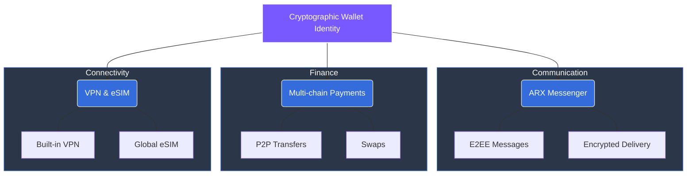

# 3.1 Unified Private Network

At the core of ARX is the unified private network, which merges **communication**, **payments**, and **connectivity** into a single, cohesive identity layer. Every interaction within the ecosystem is anchored by a cryptographic wallet that serves as both a secure authentication method and a versatile payment mechanism.

### The Three Functional Layers

ARX eliminates the need for separate, siloed applications by integrating the following services under one roof:

#### 💬 Communication
The ARX messenger provides **End-to-End Encrypted (E2EE)** communication for direct messages, group chats, and media sharing.
* **Encrypted Delivery:** Backend services operated by ARX relay encrypted messages. They cannot read message content.
* **On-Device History:** Message history is kept on users' devices. The backend holds encrypted messages only until they are delivered.

#### 💳 Payments
A built-in multi-chain wallet enables fast, peer-to-peer transfers, asset swaps, and payments to bots.
* **Self-Custody:** Private keys are generated and stored on the user’s device.
* **Versatility:** Supports QR-based transactions and in-wallet swaps.

#### 🌐 Connectivity
ARX extends privacy to the network access layer.
* **VPN:** A built-in VPN that connects through servers operated by ARX. Availability depends on the platform and app version.
* **Private eSIM:** Powered by **1GLOBAL** infrastructure, enabling mobile connectivity across multiple regions without traditional KYC-heavy registration.

---

### One Identity, Zero Friction
All three layers operate under a single **wallet-based identity**.


**No Phone Number, No Email**
ARX does not ask for a phone number or an email address to create an account. The wallet is the identity across all services.


