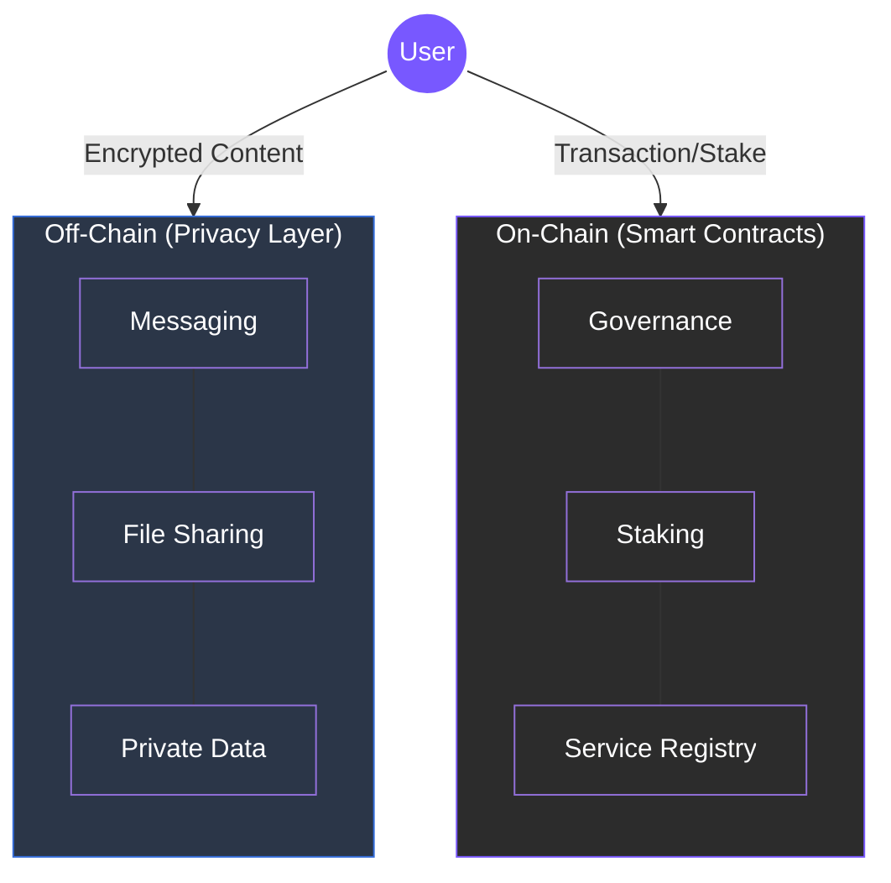

# 3.2 On-Chain Trust and Off-Chain Privacy

ARX is designed around the principle that privacy and transparency are not opposites. It separates **interaction** from **coordination** so that personal data remains private while system logic remains verifiable.

### The Hybrid Architecture

ARX splits its operations into two distinct layers:

#### 🔒 Off-chain Privacy
Communication and file transfers between users are encrypted on the device and relayed by backend services that ARX operates.
* **Nothing On-Chain:** Message content is never written to a blockchain.
* **Ciphertext Only:** The backend handles encrypted payloads and the routing information needed to deliver them. It cannot read message content.

#### ⛓️ On-chain Trust
The ARX token and its governance, staking, and service-registry logic are EVM smart contracts. They are currently deployed on the Sepolia testnet; see [Architecture](../../usdarx/architecture.md).
* **Accountability:** Contract code and on-chain activity are publicly verifiable.
* **Network Integrity:** Rules for staking and governance are enforced by the contracts rather than by policy.

---

### Layer Comparison

| Layer | Functionality | Privacy Level | Verifiability |
| :--- | :--- | :--- | :--- |
| **Off-chain** | Messaging, file sharing | **High** (Encrypted) | Low (Ephemeral) |
| **On-chain (smart contracts)** | Token, staking, governance, service registry | **Transparent** | **High** (Auditable) |

---

### Why a Hybrid Model?


**The Resulting Balance** By separating these layers, ARX keeps **performance** high (messaging does not depend on a blockchain), keeps message content **confidential** (it is encrypted on the device), and keeps token and governance rules **verifiable** (they are public contracts).

