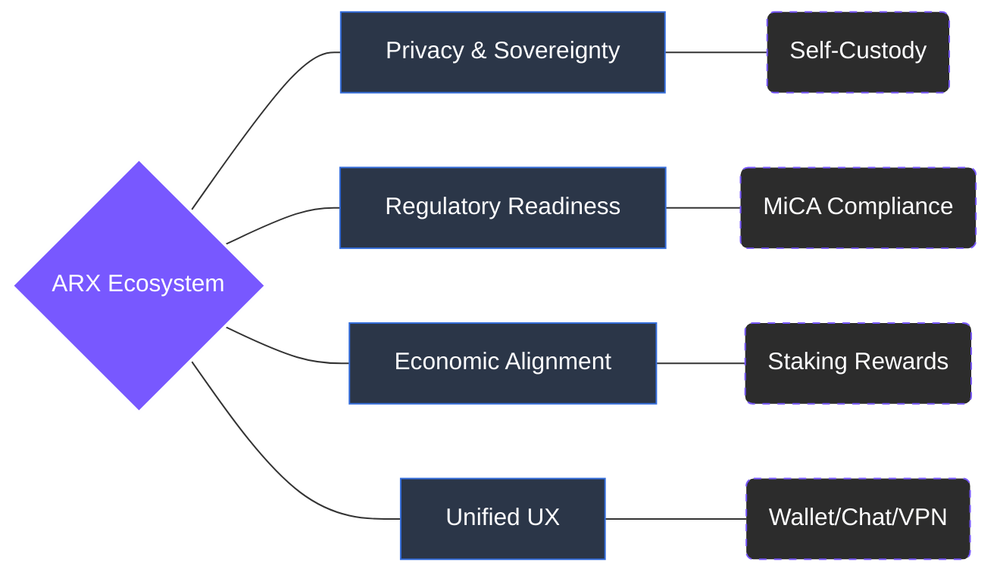

# 3.4 Competitive Edge and System Outcomes

ARX integrates architectural innovation, economic alignment, and regulatory readiness into one cohesive system. It bridges the gap between Web2 efficiency and Web3 sovereignty.

### Comparative Advantage

| **Category** | **ARX Advantage** | **Traditional or Web3 Alternative** |
| ------------------ | --------------------------------------------------------- | ------------------------------------------------- |
| **Identity** | Wallet-based authentication without phone or email        | Centralized accounts                              |
| **Privacy model** | End-to-end encrypted communication with keys kept on the device | Messages readable by the service provider         |
| **Economic model** | Token incentives for reliability and uptime (planned)     | Ad-based, subscription-based, or donation funding |
| **Governance** | On-chain voting and DAO treasury management (planned)     | Centralized decision-making                       |
| **Compliance** | Tiered KYC and MiCA-ready architecture                    | Undefined or reactive frameworks                  |
| **Integration** | Unified messenger, wallet, and VPN in one platform        | Fragmented multi-app experience                   |

---

### System Outcomes

This integrated approach aims for a system that is:

* **Private by design**: Encryption and self-custody keep message content and keys with the user.
* **Transparent by governance**: Token, staking, and governance rules live in public smart contracts.
* **Aligned by incentives**: The planned token model rewards participants for maintaining uptime, privacy, and network integrity.
* **Compliant by architecture**: Technical design supports MiCA and GDPR principles without compromising privacy.


**The ARX Edge**
ARX demonstrates that privacy, ownership, and regulation can coexist in a single, self-sustaining digital infrastructure—one where users control their communication, data, and connectivity under a unified framework.
