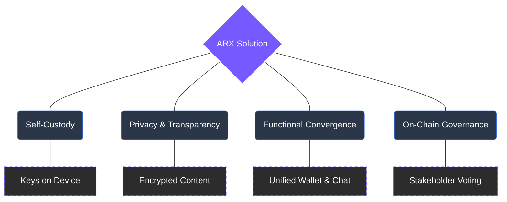

# 3 The ARX Solution

ARX is a platform designed for **digital sovereignty**. It builds identity, communication, and payments on **cryptographic ownership**.

### Core Guiding Principles

The ARX platform is built on four pillars that redefine the relationship between users and the digital services they use:

1.  **Self-Custody as a Baseline:** Users control their identity and keys directly from their devices. There are no "forgot password" links managed by corporations and no external authentication systems.
2.  **Privacy without Opacity:** Message content is encrypted on the device. The token, staking, and governance smart contracts are public and verifiable.
3.  **Functional Convergence:** ARX unifies messaging, payments, and connectivity. This allows for a seamless experience where users can transact and communicate without the friction of switching between fragmented, siloed platforms.
4.  **Governance through Participation:** ARX is designed to move toward governance by token holders through on-chain voting and staking. This is a plan; see [9 Governance model](../9-governance-model/README.md).

---

### The Foundation of Sovereignty


**Next Steps** The following sections describe how these core principles translate into the functional **Architecture**, **Economics**, and **Governance** models of the ARX network.

