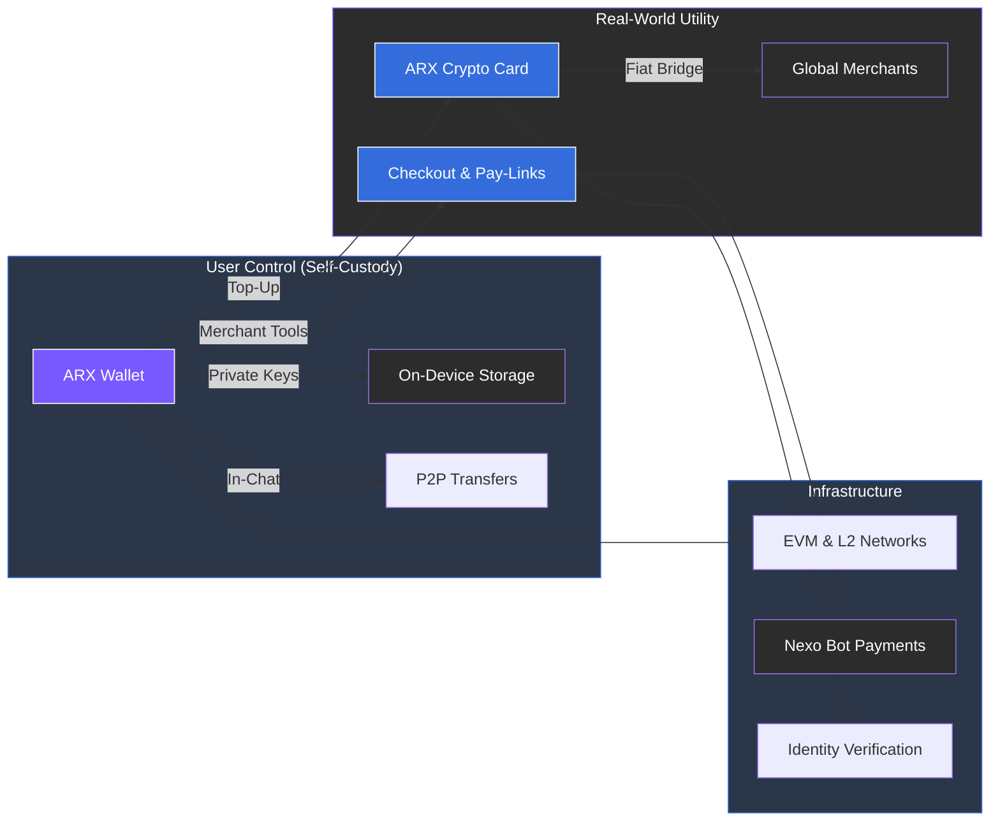

# 4.2 Fintech – Wallet, Card, Pay-Links, and Checkout

The ARX Fintech Suite connects communication with financial sovereignty. It merges a multi-chain wallet, crypto card, and checkout system into a single, self-custodial environment that allows users to send, receive, and spend digital assets seamlessly.

### ARX Wallet
* **Multi-chain Support:** Compatible with Ethereum, EVM networks, and Layer 2 solutions.
* **In-Chat Transactions:** Send or request tokens directly inside conversations.
* **Stablecoin Integration:** Facilitates everyday payments with minimal volatility.
* **Local Key Custody:** Private keys are generated and stored on-device, never on a central server.

### ARX Crypto Card
* **Fiat Bridge:** Crypto-to-fiat conversion through regulated partners for global acceptance.
* **Top-Up from the Wallet:** The card is funded by a transfer from the ARX wallet.
* **Verification:** The card provider verifies the cardholder's identity before a card is issued.

### Pay-Links and Checkout
* **Pay-Links:** Create one-click payment links.
* **QR Payments:** Instant QR code generation for in-person or event-based commerce.
* **Bot Payments:** Nexo bots sell one-time purchases and subscriptions with invoices and invoice links. See the [developer docs](../../developers/payments.md).
* **Direct Settlement:** A bot payment is a transfer from the buyer's wallet to the seller's receiving wallet, without a custodian.


**Unified Liquidity**
The Fintech vertical brings a wallet, a card, and payments into one app. Users keep control of the assets in their wallet while getting the convenience of card spending.
