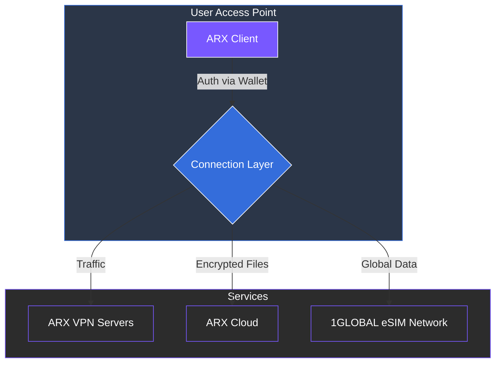

# 4.3 Connection – VPN, eSIM, and Cloud Storage

The Connection layer provides secure and borderless access to the internet. It extends ARX beyond communication and finance to network access and file storage.

### Core Networking Features

* **Built-in VPN:** The app includes a VPN that routes traffic through servers operated by ARX. Availability depends on the platform and app version.
* **Global eSIM Marketplace:** Powered by **1GLOBAL** integration, users can buy and activate mobile data packages directly within the app.

### Encrypted Cloud Storage (ARX Cloud)

ARX Cloud is an encrypted file vault inside the app.
* **Privacy and Control:** Files are encrypted before they are stored.
* **Integration:** Works with ARX Messenger for file sharing and encrypted chat backups.


**Planned network model**
The plan is for independent operators to provide VPN and storage capacity and earn ARX tokens for it. That model is not live. See [8 Economic Model](../8-economic-model/README.md).



**Beyond the App**
The Connection layer extends ARX from the application to the network and storage a user depends on, with VPN, eSIM, and encrypted file storage in one place.

