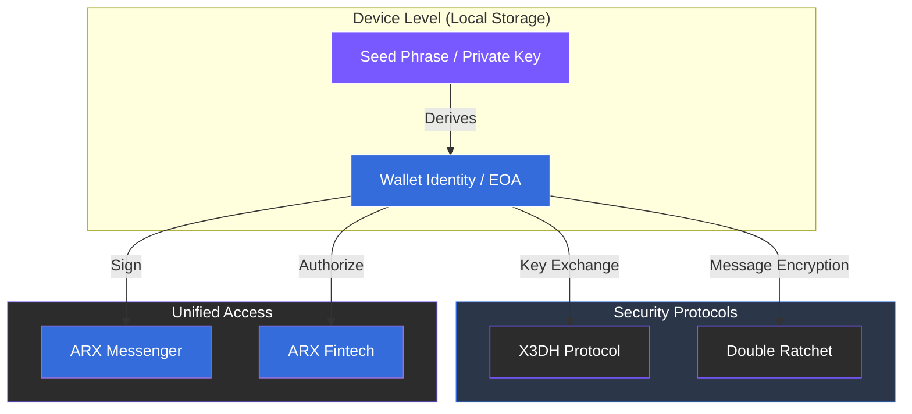

# 5.1 Identity Layer

The identity layer forms the foundation of the ARX ecosystem. Every user is represented by a cryptographic wallet that functions as the account and its authentication method. This removes the need for a phone number or an email address.

### Key Principles

* **Wallet-Based Identity:** Each user operates through an **Externally Owned Account (EOA)**. This single account signs the user in and authorizes financial transactions.
* **Signal Protocol Integration:** ARX combines the wallet identity with the **Signal Double Ratchet** and **X3DH** protocols, which provide forward secrecy for conversations between users.
* **Portable and Persistent Identity:** A user’s identity is not tied to a specific piece of hardware. It can be restored on another device using a standard seed phrase.
* **Unified Access:** One identity serves messaging, payments, and the other ARX services.

---

### Sovereignty by Design

The keys that define an identity are generated and kept on the user's device.


**Wallet-Based Login**
Signing in with a wallet means ARX does not ask for a phone number or an email address to create an account.
