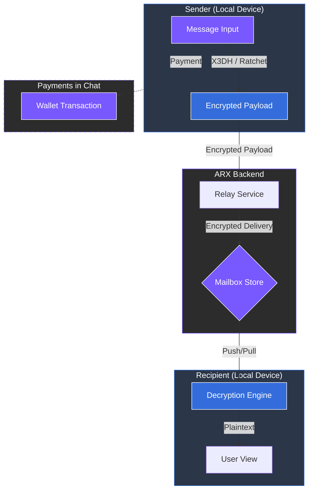

# 5.2 Messaging Layer

The messaging layer delivers private, real-time communication between users. Message content is encrypted on the sender's device and decrypted on the recipient's device. The backend that carries it works as a transport that cannot read it.

### Core Functions

* **Encrypted Payloads:** Messages and files are encrypted locally on the sender's device. This data is never stored on-chain.
* **Relay Service:** Backend services operated by ARX transport encrypted data. They cannot read message content. They process the routing information needed to deliver a message to its recipient.
* **Mailbox Architecture:** To handle asynchronous communication, ARX uses a mailbox system. It holds encrypted messages for a recipient who is offline and releases them when the recipient reconnects.
* **Payments in Chat:** Users can send or request crypto inside a conversation. The integrated wallet signs each transaction on the device.


**Bot chats are not end-to-end encrypted**
The end-to-end encryption described on this page applies to conversations between users. Chats with Nexo bots, and groups a bot has joined, are not end-to-end encrypted: ARX processes their content, and the bot's developer can read and store what users send to the bot. Starting a bot does not give it access to a user's other conversations or their encryption keys.

