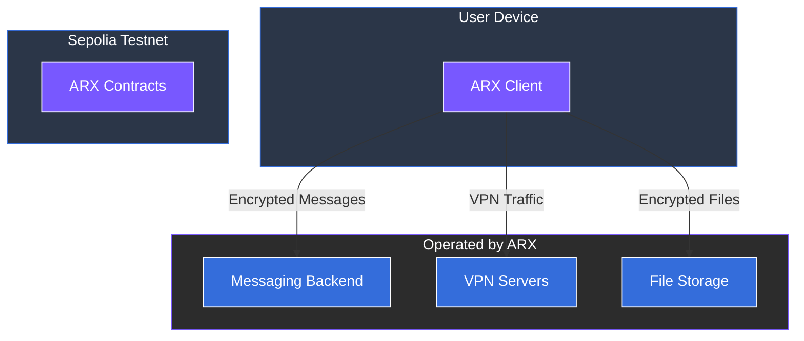

# 5.3 Network Layer

The network layer is the infrastructure that carries encrypted messages, VPN traffic, and stored files. This page describes what runs today and, separately, the model ARX plans to move to.

### The Network Today

* **Messaging Backend:** Services operated by ARX relay encrypted messages, hold them for offline recipients, and send push notifications. They cannot read message content.
* **VPN Servers:** The built-in VPN connects through servers operated by ARX.
* **File Storage:** Files are encrypted on the device and stored as encrypted data.
* **Smart Contracts:** The ARX token, sale, governance, staking, and service-registry contracts are EVM contracts deployed on the Sepolia testnet. See [Architecture](../../usdarx/architecture.md).

---

### Planned Model


The model below is a plan. It is not live.


ARX plans to open the network to independent operators through a hybrid **Proof-of-Stake (PoS)** and **Proof-of-Relay (PoR)** mechanism:

* **Relay Nodes:** Independent operators would handle encrypted message routing and VPN traffic.
* **Validator Nodes:** Would secure the chain and verify the performance of the relay set.
* **Proof-of-Relay (PoR):** Would reward nodes based on measurable performance metrics, including uptime, latency, and data throughput.
* **Slashing and Penalties:** Nodes that exhibit poor performance, downtime, or malicious behavior would lose a portion of their staked tokens.

The staking and service-registry contracts on testnet are the first building blocks of this model. The incentive design is described in [8.3 Proof-of-Relay Rewards Distribution](../8-economic-model/8.3-proof-of-relay-rewards-distribution.md).
