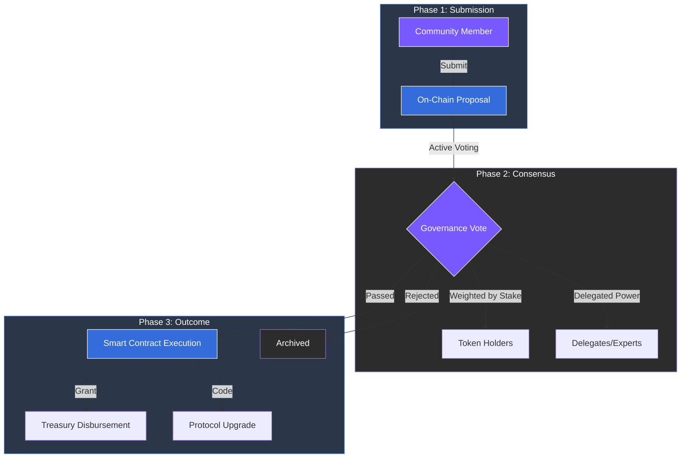

# 5.4 Governance Layer

Governance defines how ARX is meant to evolve over time through transparent, community-led processes. The design is for proposals, votes, and fund allocations to occur on-chain.


**Status**
The governance contracts (a vote-enabled ARX token, a governor, and a timelock) are implemented and deployed on the Sepolia testnet; see [Architecture](../../usdarx/architecture.md). On-chain governance is not active on a production network. The full model is described in [9 Governance model](../9-governance-model/README.md).


### Key Functions

* **Proposal System:** Token holders will be able to suggest protocol upgrades, funding initiatives, or parameter changes.
* **Token-Weighted Voting:** Voting power is proportional to the number of tokens held, and votes can be delegated to trusted parties or domain experts.
* **Treasury Management:** The ARX DAO treasury is intended to fund ecosystem development, research, and infrastructure operations, with every transaction, grant, and payment recorded on-chain.
* **Transitional Safety:** During the initial phases, a multisignature (multisig) oversight system is planned as a safety net against malicious proposals while governance moves toward full decentralization.

---

### Accountability by Default

The aim of this layer is transparency and accountability for strategic and technical decisions, by moving governance from behind closed doors to the blockchain.


**The DAO Advantage**
Decentralized governance is meant to prevent "platform capture" by any single entity, so that the protocol's evolution is driven by the people who use and secure it.
