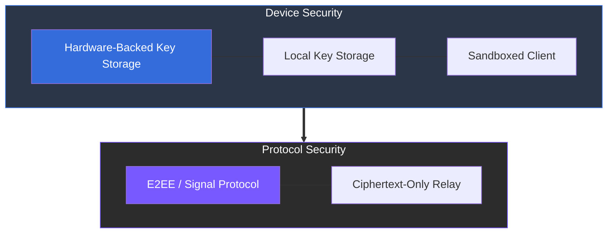

# 5.5 Security Framework

Security is integrated into every part of the ARX system. It protects communication and user assets from both technical and operational risks.

### Main Safeguards

* **End-to-End Encryption:** Ensures that only the sender and the intended recipient can access message content. Data is unreadable to anyone else, including ARX. Chats with Nexo bots, and groups a bot has joined, are not end-to-end encrypted; ARX and the bot's developer can read content sent to a bot.
* **Local Key Storage:** Private keys never leave the user’s device. The backend never holds the keys needed to read messages or move funds.
* **Device Protection:** Mobile and desktop clients use the platform's hardware-backed key storage and sandboxing where available to protect local data.

---

### Layered Defense Strategy

This layered security model protects the user at the device level and at the protocol level.


**Planned economic security**
The planned network model adds an economic layer, in which operators stake tokens and can be penalized for misconduct. It is not live. See [5.3 Network layer](5.3-network-layer.md).

