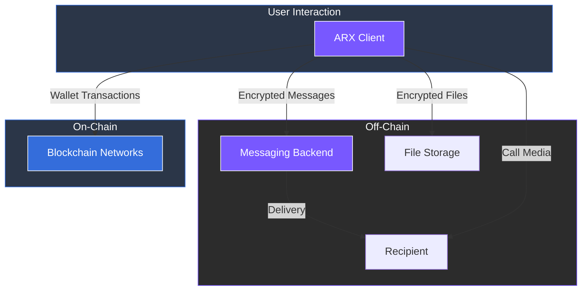

# 5.6 Scalability and Performance

ARX is designed to serve a large number of users with low latency. It does this by keeping high-frequency communication off-chain and by building the backend from services that scale independently.

### Performance Mechanisms

* **Off-Chain Communication:** Messaging and data transmission occur off-chain. A blockchain is used only for wallet transactions and for the token contracts.
* **Independently Scalable Services:** The backend is split into separate services, so each can be scaled on its own as load grows.
* **Direct Media Paths:** Call audio and video travel between the participants' devices over WebRTC where a direct path is available, so the backend carries signaling rather than media.
* **Separate File Path:** Files are encrypted on the device and uploaded separately from messages, which keeps message delivery fast.


**Efficiency through Decoupling**
Because messaging does not depend on a blockchain, message delivery is not limited by on-chain throughput or fees.

