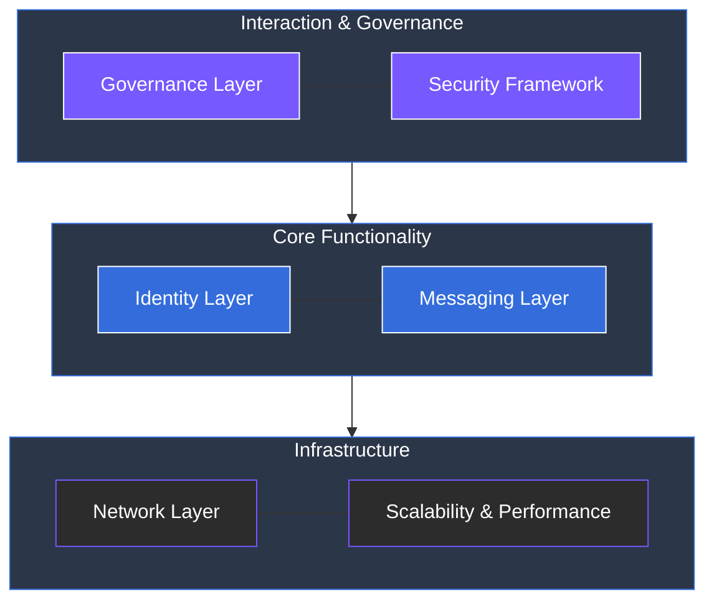

# 5 System Architecture

The ARX system architecture defines how privacy and scalability operate together within one framework. It connects communication, payments, and governance under a single, modular structure.

This section describes the system as it runs today. Where a layer also has a planned model, the page says so.

### The Technical Layers

Each component works independently but contributes to the overall network integrity and security across several distinct layers:

* **Identity Layer:** Establishes wallet-based user authentication.
* **Messaging Layer:** Delivers end-to-end encrypted, off-chain communication between users.
* **Network Layer:** The infrastructure that carries messages, VPN traffic, and files. It is operated by ARX today; a model with independent operators is planned.
* **Governance Layer:** The on-chain voting contracts and the planned governance process.
* **Security Framework:** Protection at the device and protocol levels.
* **Scalability & Performance:** Optimizes throughput and efficiency for large-scale adoption.

---

### Structural Overview

This multi-layered approach keeps the system fast enough for daily use while keeping message content end-to-end encrypted.


**Modular Resilience**
Identity and wallet keys are held on the user's device, so a failure in another layer does not expose them.
